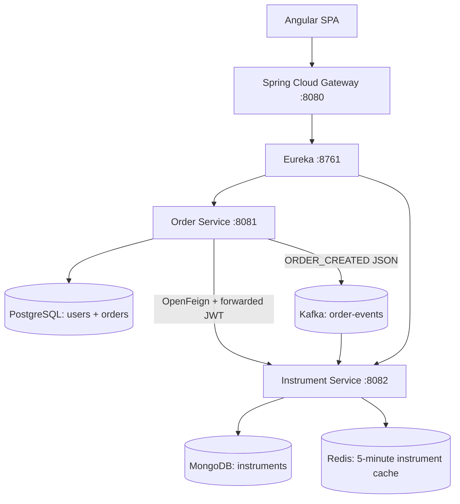

# Architecture and request flow

## Ownership boundaries

Order Service owns PostgreSQL and order lifecycle rules. Instrument Service owns MongoDB, instrument validation, cache entries, and the activity counter updated by Kafka. Neither service queries the other service's database. Gateway routes by Eureka service ID, while Feign makes synchronous instrument checks before an order is stored. Kafka is asynchronous and is used only after the order is persisted.

## Request lifecycle: create an order

1. User logs in; Order Service checks the BCrypt hash and returns a signed JWT with username and role claims.
2. Angular interceptor adds `Authorization: Bearer ...` to API calls.
3. Gateway routes `/api/orders/**` to Order Service using Eureka.
4. Order Service validates request fields and calls Instrument Service via Feign, forwarding the authorization header.
5. Instrument Service validates JWT, checks Redis, then MongoDB on a cache miss; inactive/missing instruments are rejected.
6. Order Service saves the order in PostgreSQL and emits `ORDER_CREATED` to Kafka.
7. Instrument Service consumes the event and increments its activity counter.
8. Admin may approve/reject a submitted order; an owner may cancel their own submitted order. Terminal states cannot be transitioned again.
